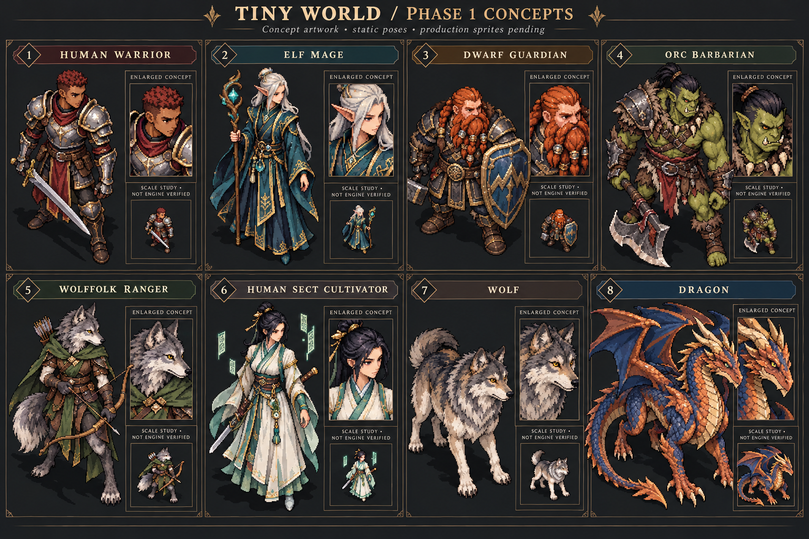
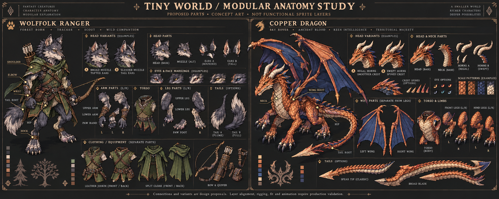
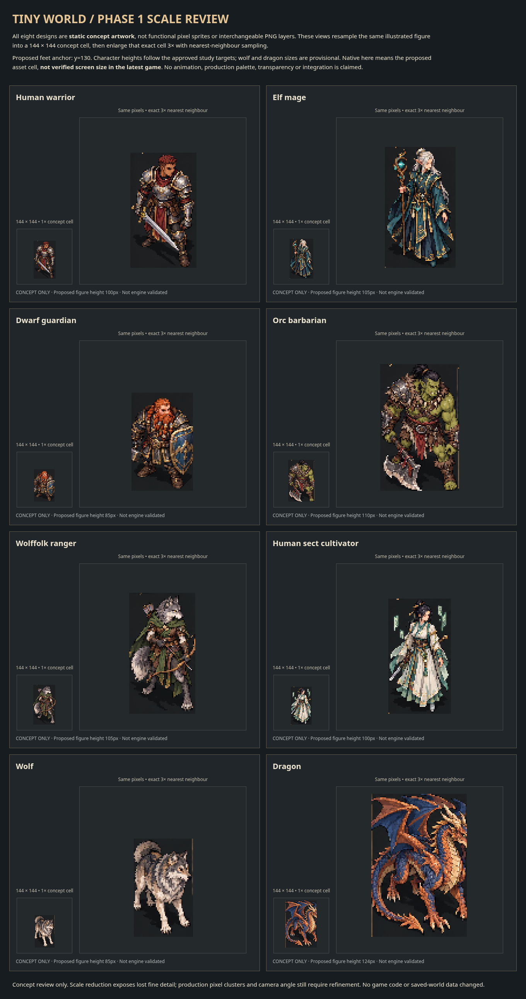

# Tiny World — Phase 1 art review

This repository currently contains the Phase 1 concept-art review package only. These are static concepts, not functional sprite assets. No game code or saved worlds are included or modified.

## Download

[Download the complete review ZIP](https://github.com/christianfordjor1-cell/better-worldox/raw/refs/heads/main/art-review/phase-1/tiny-world-phase1-review.zip)

## Eight original designs

## Proposed wolffolk and dragon anatomy

These illustrations demonstrate proposed part boundaries and attachment sites, not validated interchangeable production layers.

## Native-size concept cells and exact nearest-neighbour enlargements

The proposed asset cells are 144 × 144 pixels. Actual gameplay screen size and camera angle remain unverified without the latest authoritative game source.

[Detailed notes and limitations](art-review/phase-1/README.md) · [Preview validation](art-review/phase-1/preview-validation.json)

The ZIP includes a standalone HTML scale reviewer and individual previews. Extract it and open `scale-review.html` in a browser.

No full sprite pack or game integration has been performed. No missing sect registry has been invented. Awaiting Phase 1 visual feedback before further art production.
