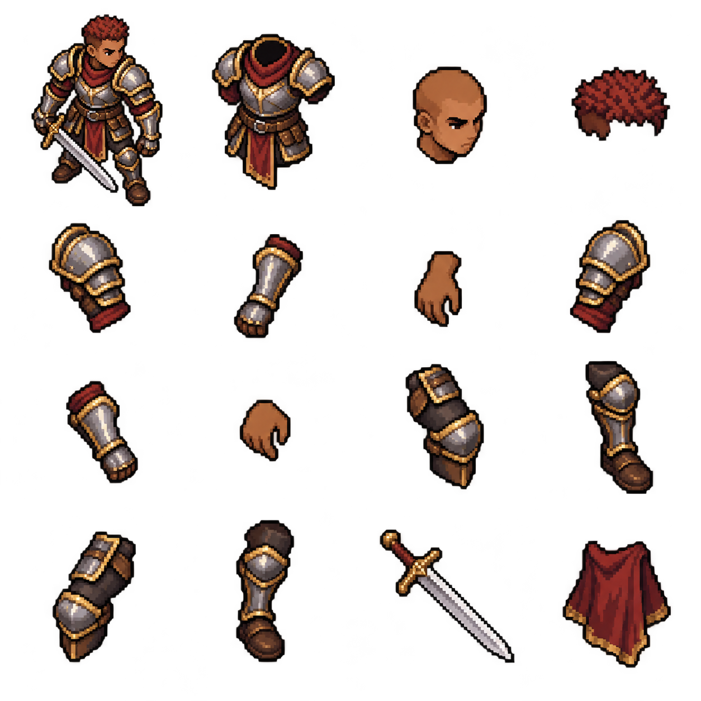
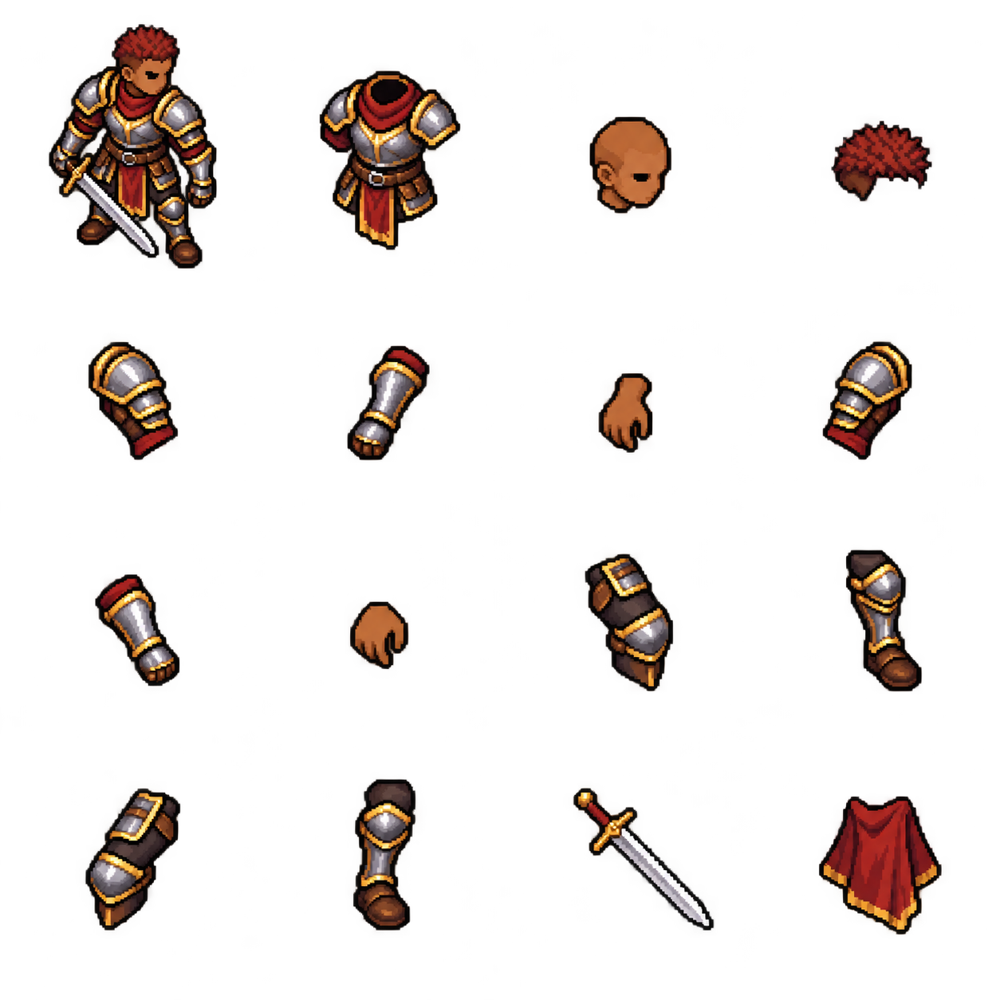

# Phase 2 production feasibility audit — BLOCKED

**These PNGs are rejected generation tests. They are not approved art, production sprites, aligned part assets, animation sheets or a completed Phase 2 proof of concept.**

The requested scope remains human warrior, wolffolk ranger and dragon only. No main-game files were modified. The Phase 1 artwork remains unchanged.

## Evidence

A human-warrior anatomical source-sheet test was generated from the approved concept. A second focused correction requested consistent pixel scale, binary transparency, flat limited palettes, correctly segmented parts and a precise regular layout. Both failed.

| Check | Candidate 1 | Candidate 2 |
|---|---:|---:|
| Requested source sheet | 1024 × 1024 | 1152 × 1152 |
| Actual source sheet | 1254 × 1254 | 1254 × 1254 |
| Exact 4 × 4 integer-cell layout | Failed | Failed |
| Visible RGB colours | 113,416 | 95,314 |
| Partial-alpha pixels | 418,680 | 288,255 |
| Binary alpha only | Failed | Failed |
| Production acceptance | Rejected | Rejected |

The requested source sheets were intermediate anatomical-art grids, not the final required 144 × 144 animation cells. Their failure is not a substitute for a test of completed 144 × 144 sheets: no completed sheets exist.

Visual inspection also found inconsistent head/torso/limb scale; shoulder and joint art duplicated between components; embedded facial features rather than independent feature assets; and source parts that cannot simply be overlaid into an anatomically correct character.

## Rejected test images

### Initial test



### Focused correction



The previews may appear convincing at first glance. Their appearance does not establish usable pixel layers or animation.

## Reproduce the read-only audit

Requires Python 3 and Pillow. From this directory:

```sh
python audit_candidate.py warrior-candidate-1-REJECTED.png --expected 1024
python audit_candidate.py warrior-candidate-2-REJECTED.png --expected 1152
```

The script only inspects pixels; it does not rescale, quantize, recolour, threshold or otherwise alter the source images. Machine checks are deliberately limited; passing them would still require anatomical, visual and animation review.

## Required work that is incomplete

- Deliberately refined 144 × 144 production sprite layers with body centre x=72 and feet anchor y=130.
- Properly fitted head, face, torso, left/right articulated limbs, equipment and species attachments.
- Independent tint-mask channels.
- Genuine idle, walk, attack, hurt, death and required contextual action poses.
- Three interchangeable wolffolk assemblies using different muzzles, ears, tails, body variants and outfits.
- Three interchangeable dragon assemblies using different horns, wings, crests, tails and scale patterns.
- A standalone actual-PNG layer-composition and animation viewer, with native and nearest-neighbour views.
- Frame alignment, attachments, clipping, palette isolation, meaningful part swaps and animation validation.

Those checks were **not run**, because the required assets do not exist. No test claims gameplay readiness or visual acceptance. No wolffolk or dragon production assets were generated after the warrior source-art gate failed. No mass production or integration occurred.

## Blocker and continuation

The available image-generation tool did not reliably supply precision pixel anatomy assets even after a focused correction. Resizing, alpha-thresholding or quantizing these samples would not establish intentional pixel clusters, correct anatomy, or missing poses.

Production needs pixel-artist-authored/refined layered animation assets. The approved Phase 1 designs remain the art direction. Once actual production parts and poses exist, the compositor, mask pipeline, viewer and regression checks can be implemented against them. Integration remains gated on the latest authoritative game source and separate approval.
