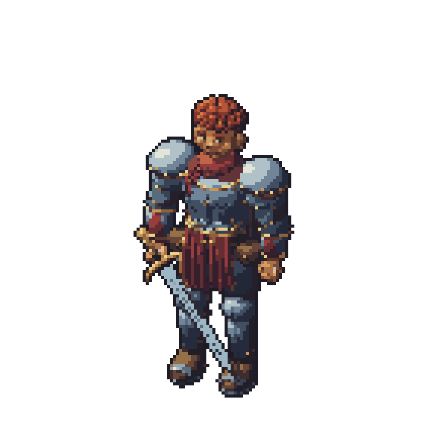
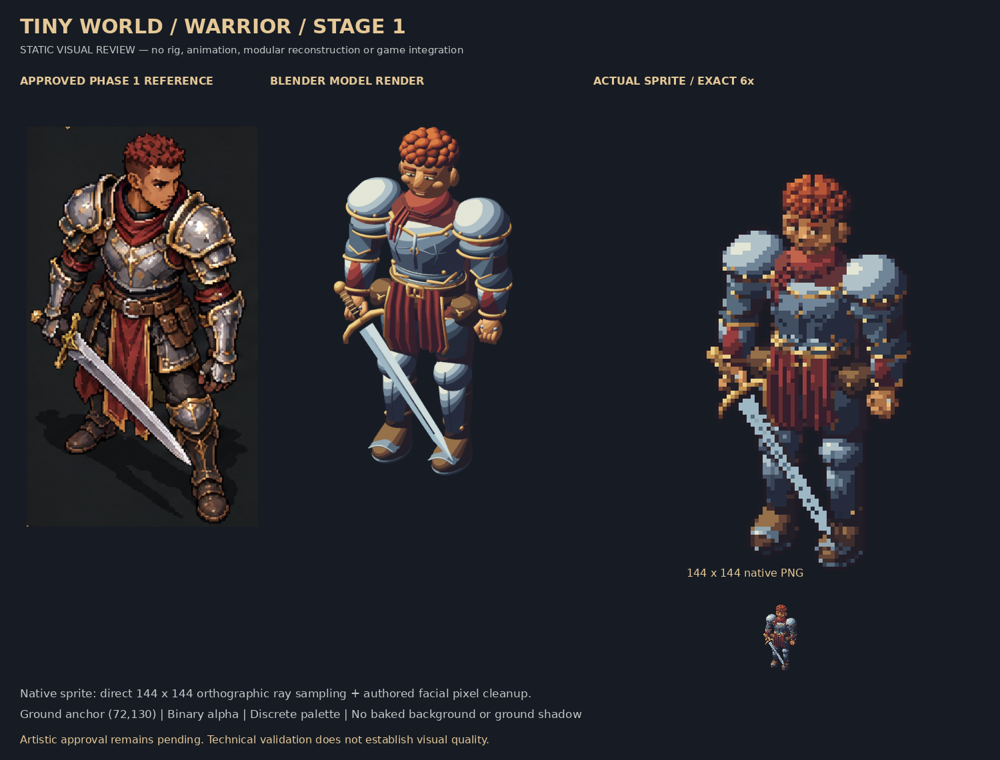
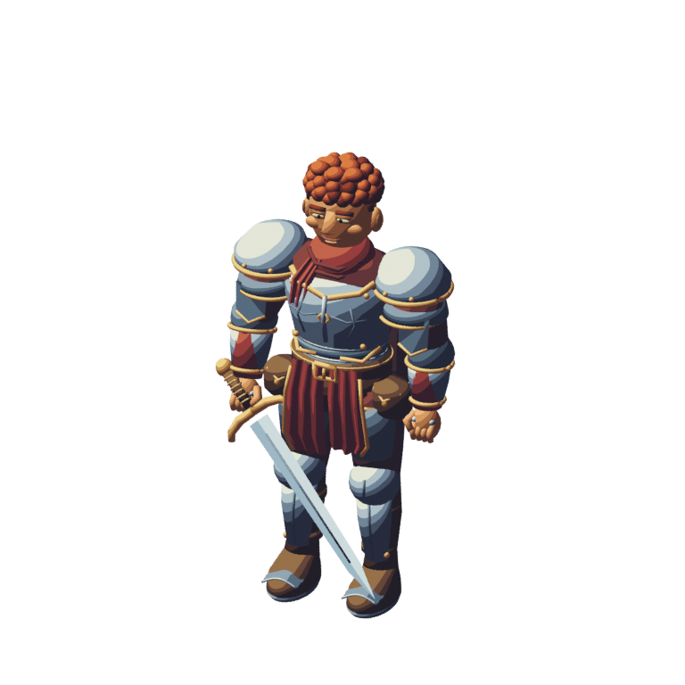

# Tiny World — Warrior Stage 1 review

**Start here. No Blender knowledge or extraction is needed to review this page on GitHub.** The pictures below are the actual existing artwork. This is Stage 1 only; your visual approval is pending.

[Download Tiny-World-Warrior-Stage1-Review.zip](https://github.com/christianfordjor1-cell/better-worldox/raw/refs/heads/prototype/blender-warrior-stage1/prototypes/blender-warrior-stage1/review/Tiny-World-Warrior-Stage1-Review.zip)

## 1. Complete native sprite — 144 × 144

## 2. Pixel-perfect detail preview — exact 6×

## 3. Comparison with the approved Phase 1 warrior

## 4. Blender model render

## 5. Technical validation

[Read the plain-language report](Technical-Validation-Report.md) · [Original machine-readable results](validation.json)

All 16 recorded checks passed. Visual quality remains for you to judge. The model has rounder shoulder armour and simpler ornament than the approved illustration.

## 6. Editable Blender file

[Download the editable warrior-stage1.blend](https://github.com/christianfordjor1-cell/better-worldox/raw/refs/heads/prototype/blender-warrior-stage1/prototypes/blender-warrior-stage1/review/warrior-stage1.blend)

You do not need Blender to inspect any PNG. If you want to edit the model, open this file in Blender 4.3.2 or a compatible later version.

## Using the ZIP

The ZIP contains these files directly at its top level:

| File | Purpose |
|---|---|
| `warrior-144.png` | Actual transparent native sprite |
| `warrior-nearest-6x.png` | Large pixel-perfect preview |
| `warrior-preview-3x.png` | Compact pixel-perfect preview for chat |
| `comparison.png` | Side-by-side approved concept/model/sprite comparison |
| `blender-model-render.png` | PNG of the Blender model |
| `Technical-Validation-Report.md` | Readable technical report |
| `validation.json` | Original technical results and asset hashes |
| `warrior-stage1.blend` | Editable Blender model |
| `README.md` | This review guide |

After downloading, use your device's **Extract All** or **Unzip** option, then open the PNG files normally. Alternatively, review all the pictures directly on this GitHub page.

**Stopped at Stage 1.** No Stage 2 work or main-game/save changes are included.
