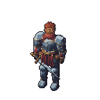
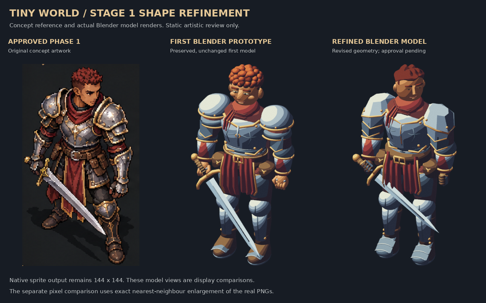
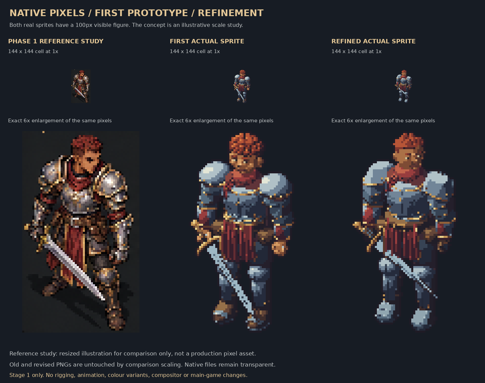
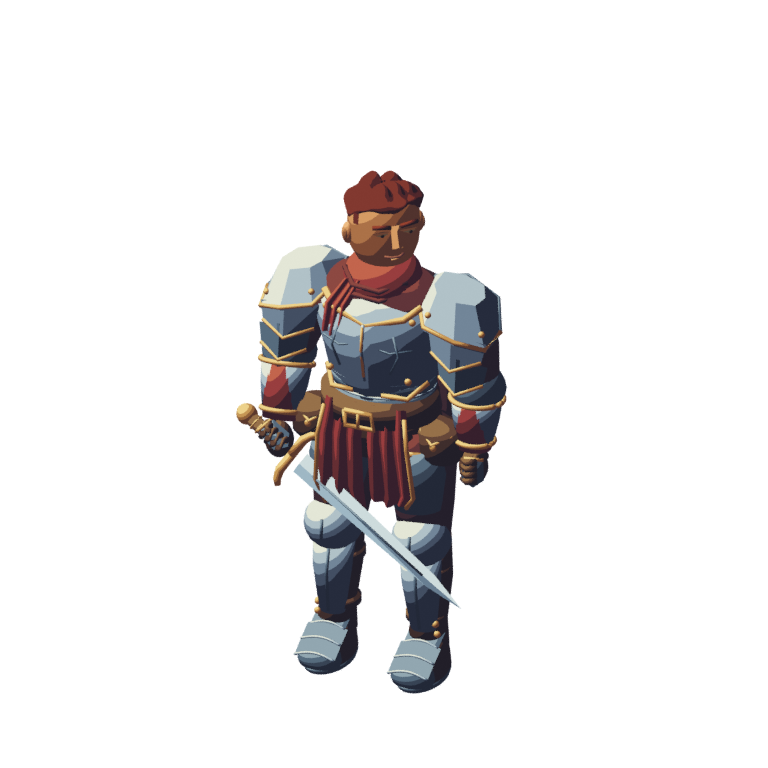

# Tiny World — revised Stage 1 warrior review

**Visual refinement only. Stage 2 has not started.** You can inspect these images directly on GitHub without opening Blender.

## Actual native sprite — 144 × 144

## Pixel-perfect detail preview — exact 6×

## Approved concept, first model and revised model

## Native-scale and enlarged pixel comparison

## Actual Blender model render

[Light/dark/transparency review](transparency-review.png) · [Readable validation report](Technical-Validation-Report.md) · [Machine-readable report](validation.json) · [Editable Blender file](warrior-stage1.blend) · [Download complete ZIP](https://github.com/christianfordjor1-cell/better-worldox/raw/refs/heads/prototype/warrior-stage1-refinement/prototypes/warrior-stage1-refinement/artifacts/Tiny-World-Warrior-Stage1-Refined-Review.zip)

The native PNG has no background or ground shadow. The separate model illustration uses normal renderer filtering; it is not the pixel sprite.

[Read the shape changes and remaining scope](Changes-For-Review.md). The underlying shape changes and visual differences are for your review. Technical validation does not decide artistic acceptance. All source/scripts included under `source/` are free-tool workflows.

**Stop at Stage 1.** Rigging, modular reconstruction, animation, palette-variation systems and game integration remain unimplemented and require later approval. The main game and existing saves are unchanged.
